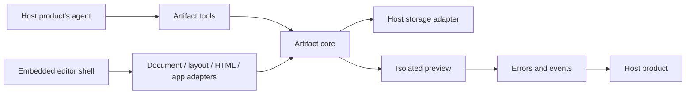

# Open Artifacts

An embeddable artifact SDK for products with AI agents. Agents create documents, layouts, HTML pages, and apps; users edit them directly using an editor suited to each artifact type. Both continue working from the same saved artifact.

**Status:** Design stage. This repository currently documents the proposed SDK; packages, APIs, and runnable examples are not implemented yet.

## Documentation

Design:

- [SDK architecture](docs/design/architecture.md): package boundaries, saved artifact model, shared update flow, and isolation.
- [Glossary](docs/design/glossary.md): shared vocabulary used across these documents.
- [Accessibility and localization](docs/design/accessibility-i18n.md): requirements for the default editor shell.

Contracts:

- [Embed API](docs/contracts/embed-api.md): trusted host-facing API, controller, events, slots, and error codes.
- [Host adapters](docs/contracts/host-adapters.md): storage, authorization, and asset interfaces, with a revision envelope example.
- [Agent tools](docs/contracts/agent-tools.md): tool input/output schemas and the conflict response.
- [Artifact runtime SDK](docs/contracts/runtime-sdk.md): context/theme API and host bridge protocol for HTML and React previews.

Decisions:

- [Decision records](docs/decisions/README.md): open design questions and their recorded resolutions.

Plans and notes:

- [Implementation plan](docs/plans/2026-10-09-sdk-implementation-plan.md): delivery sequence, acceptance criteria, and verification strategy.
- [Implementation note](docs/implementation-notes/2026-10-09-sdk-foundation.md): current status, decisions, and verification record.

The full index with folder conventions is in [docs/README.md](docs/README.md). Product reference studies live in `docs/references/`, which is local-only and not committed.

## Goal

Give software teams a reusable foundation for a Claude-style artifact experience inside their own products. Each product brings its own agent, model provider, authentication, and storage.

Example uses include editable reports, landing pages, calculators, and dashboards. The SDK targets browser-based products, with four planned editor adapters. HTML/CSS artifacts are the proposed first implementation milestone.

## User experience

1. Ask the product's agent to create an artifact.
2. Open the generated result in the embedded editor.
3. Edit the artifact using its document editor, visual layout editor, HTML editor, or source editor.
4. Save a version and ask the agent for further changes.
5. Review earlier versions, restore one, or export in a format supported by that artifact type.

User edits must persist in the artifact model. Changing only the preview DOM is insufficient because those edits would disappear when the artifact renders again.

## Technology direction

| Layer | Initial choice | Purpose |
| --- | --- | --- |
| Core SDK | TypeScript | Artifact types, validation, operations, and integration contracts |
| Editors | Optional adapters per artifact type | Use the appropriate editing model for each artifact |
| Embedding | Plain JavaScript API | Allow integration across frontend frameworks |
| React integration | Optional React wrapper | Convenient component integration for React products |
| Persistence | Host-provided storage adapter | Let each product own its data and backend |
| Agent integration | Tool definitions and handlers | Connect artifact operations to the host's agent |
| Preview | Isolated iframe runtime | Run interactive content separately from the host application |

### Editor adapters

| Artifact type | Editor / runtime | Direct editing experience | Editable source |
| --- | --- | --- | --- |
| Documents with interactive blocks (`document`) | [ProseMirror](https://prosemirror.net/docs/guide/) | Edit text, tables, and supported custom blocks inside a document | Schema-defined document JSON |
| Drag-and-drop dashboard layouts (`layout`) | [Puck](https://puckeditor.com/docs) | Arrange registered components, change their properties, and edit configured text fields inline | Component layout JSON |
| Editable HTML pages (`html`) | [GrapesJS core](https://grapesjs.com/docs/modules/Components) | Edit page text, components, and styles visually | GrapesJS project JSON |
| Generated apps with source editing (`app`) | [CodeMirror](https://codemirror.net/docs/guide/) + [Sandpack Client](https://sandpack.codesandbox.io/docs/advanced-usage/client) | Edit source files and see the running app update | Files, entry point, and dependency configuration |

These are complementary adapters, not dependencies every product must install. Hosts select the artifact types they need and load the corresponding editors on demand. The core package must not import editor or runtime packages.

For documents, the adapter uses ProseMirror directly with a hand-written schema; see [decision 0006](docs/decisions/0006-document-adapter-library.md). Charts, forms, and embedded previews require custom node views and controls. The configured document schema determines what the agent can create.

For layouts, Puck uses components registered by the product or SDK. Its editable rich-text fields can support [inline text editing](https://puckeditor.com/docs/api-reference/fields/richtext). It does not automatically make arbitrary React source visually editable.

GrapesJS core is free and open source under the [BSD 3-Clause license](https://github.com/GrapesJS/grapesjs/blob/dev/packages/core/LICENSE). Preserve its required copyright and license notices when distributing it. GrapesJS Studio SDK is a separate commercial offering and is not required for this design.

For apps, CodeMirror edits source and Sandpack runs the preview. Visual editing of arbitrary generated React applications is outside the initial scope. Source edits do not automatically become editable Puck or GrapesJS projects. Converting between artifact types requires an explicit conversion path and may lose information.

## Proposed architecture



The core owns artifact identity, revisions, authorization hooks, storage, and shared events. Each adapter owns its editable payload, schema validation, supported changes, rendering, and exports. User edits and agent updates pass through that adapter and the same revision checks.

Proposed package boundaries:

```text
packages/
  core/               # Shared contracts and revision handling
  embed/              # JavaScript editor shell and adapter loading
  react/              # Optional wrapper around the embedding API
  runtime/            # Isolated artifact client and trusted host bridge
  tools/              # Provider-independent agent tool definitions and handlers
  adapter-document/   # ProseMirror
  adapter-layout/     # Puck
  adapter-html/       # GrapesJS core
  adapter-app/        # CodeMirror and Sandpack
```

These packages are a proposed structure; they do not exist yet. A React-based adapter can render inside the embedded shell without requiring the host application to use React.

The design follows established editor-SDK architecture: a typed editor controller over structured state and schemas, registered extensions, and replaceable default UI. User controls and agent tools use the same controller operations. Document data, local editor session state, and saved revision history remain distinct. The base core and runtime stay independent of React and editor libraries.

### Artifact storage

Each saved revision should include:

- Artifact ID and host-defined owner or workspace scope.
- Title and artifact type.
- Revision number and document schema version.
- Adapter identifier, adapter schema version, and editable payload for continued editing.
- Creation time and change origin, such as user or agent.
- References to uploaded assets when needed.

Persist each adapter's editable source, as listed above. Treat previews and exports as derived outputs. For HTML artifacts, persist GrapesJS project JSON; do not use exported HTML/CSS as a substitute for project data. See the [GrapesJS storage guidance](https://grapesjs.com/docs/modules/Storage.html).

Save the schema version with each revision and define migrations when an adapter's document format changes. Restoring an old revision must validate or migrate its payload before opening it in the current editor.

### Agent tools

The proposed tool contract includes:

| Operation | Behavior |
| --- | --- |
| `create_artifact` | Select an artifact type, validate its initial payload through the adapter, and return its ID and revision |
| `read_artifact` | Return the current document and revision |
| `update_artifact` | Apply validated changes to a specified base revision |
| `list_artifact_versions` | Return saved revision metadata |
| `restore_artifact_version` | Create a new revision from a previous revision |

These live in the proposed `packages/tools` package, which depends on core and never on an editor or model provider; see the [agent tools contract](docs/contracts/agent-tools.md). Expose the selected adapter's schema and supported operations to the agent. Prefer targeted edits: document text or block changes, layout component property changes, HTML component or style changes, and app file changes. Both the editor and agent tools must use the same validation and persistence rules.

When an update is based on an old revision, return a conflict so the agent can read the latest content and retry. Do not silently overwrite edits made while the agent was generating a response.

### Host integration

The host product provides authentication, authorization, storage, and agent execution. The SDK provides the artifact editor, operations, and events.

Start with a JavaScript mount/unmount API and an optional React component. Let hosts register enabled adapters and select the editor from the artifact type. Expose events for changes, saves, conflicts, and preview errors. The host passes theme and locale as session context; both reach the editor shell and the isolated preview but are not part of the saved artifact. A chat interface or side panel belongs to the host product's layout.

MCP can be added as an agent adapter later. Embedded interfaces through MCP Apps require support from the host client; the direct SDK remains the general integration path.

### Runtime boundaries

Generated scripts are untrusted. Disable their execution in the HTML editing canvas and use a separately isolated runtime for interactive previews and app artifacts. Document node views and layout components should come from the trusted component registry; generated executable code belongs in an isolated preview. An editor canvas iframe alone is not a complete security boundary.

Keep API keys and host credentials outside artifacts. Use restrictive sandbox and content security policies. If an artifact needs product data or actions, route requests through an explicit host bridge with validated messages and host-side authorization.

## First milestone

- Create, open, and save an HTML/CSS artifact.
- Edit text, styles, and supported components directly with GrapesJS.
- Apply agent changes to the same editable project.
- Detect stale revisions and preserve version history.
- Preview supported interactive content in isolation.
- Export HTML/CSS.
- Demonstrate integration in plain JavaScript and React.

Acceptance scenario: an agent creates a calculator, a user changes its title and colors, the agent adds a supported feature without losing those edits, and the user restores an earlier revision.

## Roadmap after the first milestone

1. Add the document adapter using ProseMirror, including custom interactive blocks.
2. Add the layout adapter using Puck and a configurable component registry.
3. Add the app adapter with CodeMirror source editing and Sandpack previews.
4. Add collaborative editing with an explicit concurrency model, plus further agent and storage adapters.

For each editor adapter, verify that user edits persist after reopening, agent changes preserve unrelated user edits, stale revisions are rejected, and restoration and exports behave as documented. A single visual editor will not cover every artifact type.

## Development status

There is no install or development command yet. Implementation should begin with the first milestone and two host examples before expanding the SDK's public API. See [CONTRIBUTING](CONTRIBUTING.md) for how to take part and [CHANGELOG](CHANGELOG.md) for what has changed. The repository is released under the [MIT license](LICENSE), recorded in [decision 0007](docs/decisions/0007-open-source-license.md).
