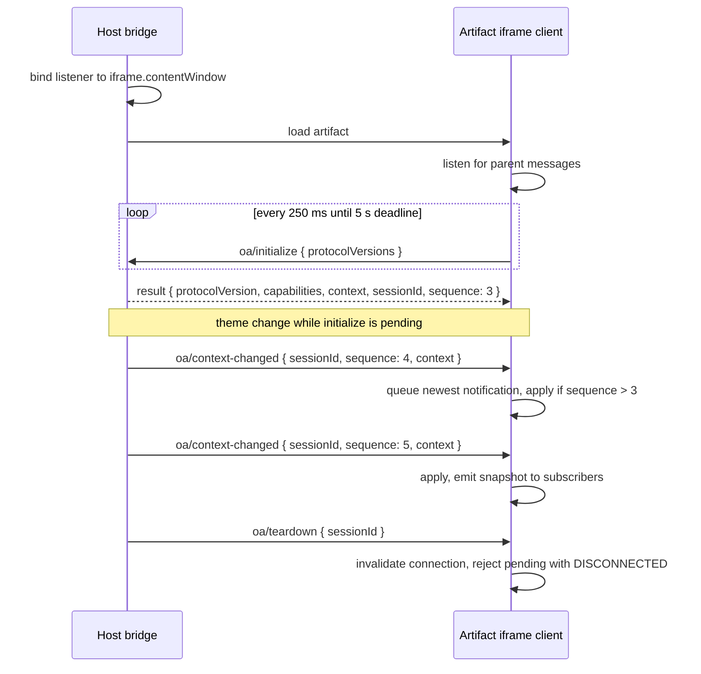

# Artifact runtime SDK contract

Status: Proposed v1 contract; APIs and packages below do not exist yet.

This is the first technical slice in the [SDK plan](../plans/2026-10-09-sdk-implementation-plan.md). It serves JavaScript/TypeScript running inside isolated HTML or React previews. The trusted editor embedding API is a separate concern; see [architecture](../design/architecture.md).

The editor-controller design in [architecture](../design/architecture.md) informs the trusted controller, structured snapshots, and extension boundaries. This iframe API remains limited to public context/theme access; the trusted controller, document store, and adapter registry are never exposed through it. Host-propagated theme updates are runtime/session events and do not modify the saved artifact document.

## Initial API

Proposed package name: @open-artifacts/runtime. Availability and naming must be checked before publication.

```ts
type ArtifactKind = "html" | "document" | "layout" | "app";

type ArtifactContext = Readonly<{
  artifactId: string;
  viewedRevision: number;
  kind: ArtifactKind;
  theme: "light" | "dark";
  locale: string;
}>;

type Capability = "context.read" | "context.subscribe";

type Connection = Readonly<{
  protocolVersion: 1;
  capabilities: readonly Capability[];
  context: ArtifactContext;
}>;

interface ArtifactClient {
  connect(): Promise<Connection>;
  context: {
    get(): ArtifactContext | undefined;
    subscribe(listener: (context: ArtifactContext) => void): () => void;
  };
  dispose(): void;
}
```

The v1 capability vocabulary is context.read and context.subscribe. The host returns the subset its policy allows; the client must not assume any member is present. Future capabilities extend the Capability union and arrive through the same negotiated list.

createArtifactClient() creates one client. connect() resolves after host validation and protocol negotiation. Repeated calls share the same in-progress connection and return the active connection after success. A failed attempt releases its resources so a later explicit call can retry. No caller has to send raw bridge messages.

context.get() is undefined before initialization and after disposal. Snapshots are immutable copies. subscribe() may be called before connecting; it emits the initial snapshot and subsequent changed snapshots, returning an idempotent unsubscribe function. Registering after connection immediately emits the current snapshot. Listener failures must not prevent delivery to other subscribers.

dispose() is idempotent and terminal: remove listeners, clear timers and subscriptions, and reject pending connect() with DISPOSED. Later connect() rejects with DISPOSED. React cleanup disposes its own client; a new effect instance creates a fresh one, including development Strict Mode remounts.

## Host API

Expose a separate trusted entry point, proposed as @open-artifacts/runtime/host:

- createArtifactHostBridge({ iframe, context }) binds a bridge to one iframe and a host-supplied, validated context.
- setContext({ theme, locale }) publishes changed context. Artifact identity, kind, and viewed revision are immutable within the session.
- dispose() removes listeners and sends teardown when possible.

Bind the host listener before navigating/loading the artifact. The host remains authoritative for identity and revision; ignore any client-supplied replacements. A frame load after an established session invalidates that session. Navigating to a different artifact or revision disposes and recreates the bridge with new host context.

Plain HTML and React examples use this same host API. Artifact React hooks consume the same core client through an optional /react entry; React is a peer dependency and must not be imported by the base runtime entry.

## Protocol and lifecycle

Use [JSON-RPC 2.0](https://www.jsonrpc.org/specification) over window.postMessage. Reserve oa/ method names; separate the protocol version from the npm package version.

| Method | Direction | Behavior |
| --- | --- | --- |
| oa/initialize | Client -> host request | Advertise supported protocol versions; return selected version, public capabilities, host context, and a fresh session ID |
| oa/context-changed | Host -> client notification | Supply the session ID, a strictly increasing context sequence, and a full context snapshot |
| oa/teardown | Host -> client notification | End the matching connection and invalidate cached context |



The initialize result includes the current context sequence. Requests use unique IDs; responses must match the active request and sender. A valid repeat of the same initialization request within the current frame session returns the same negotiated result. Once connected, a second SDK client may receive the same session context; it does not receive additional permissions.

The client listens before sending initialize. Retry the same initialization request on a bounded interval until a default 5-second deadline, covering host/frame startup ordering. Default retry interval: 250 ms. Allow test/configuration overrides, validate positive finite bounds, and stop retries on success, failure, or disposal. Queue only the newest matching-session context notification that arrives during initialization, then apply it if its sequence exceeds the initialization snapshot. This prevents theme changes during startup from being lost or applied out of order.

On teardown or navigation, invalidate subscriptions' connection state and reject pending operations with DISCONNECTED. A terminally disposed client cannot reconnect; a disconnected client can explicitly connect again. Late responses from old requests/sessions cannot restore a connection.

Reject incompatible initialization with PROTOCOL_MISMATCH; do not silently downgrade to unknown semantics. Use stable SDK error codes TIMEOUT, PROTOCOL_MISMATCH, INVALID_MESSAGE, DISCONNECTED, DISPOSED, and HOST_UNAVAILABLE. Map these to JSON-RPC errors with the SDK code in error data. A top-level standalone preview without a parent rejects immediately with HOST_UNAVAILABLE; an unrelated parent eventually times out. Context/theme v1 exposes no write methods.

## Message boundary

Validate all JSON-RPC envelopes, request IDs, method names, session IDs, sequence numbers, context fields, and size limits at runtime. Set the initial control-message size limit to 16 KiB. Silently ignore unrelated/wrong-source traffic; reject a malformed matching initialization response with INVALID_MESSAGE so it cannot leave the client pending indefinitely. Reject unsupported valid requests with JSON-RPC Method not found.

The host accepts initialization only when event.source equals the configured iframe.contentWindow. The client accepts host messages only from its configured parent window. An opaque-origin artifact reports origin "null", which is not an identity. Sending to that iframe requires targetOrigin "*"; target the host's exact origin from the artifact when a trusted bootstrap supplies it. Recreate session bindings after navigation and never send secrets through the wildcard destination. See [MDN's sandbox messaging guidance](https://developer.mozilla.org/en-US/docs/Mozilla/Add-ons/WebExtensions/manifest.json/sandbox#best_practices).

Only public context crosses this bridge. Capability declarations do not grant permissions: host policy selects the allowed set, and the host must enforce it for every future operation even when the caller bypasses the SDK. Session IDs bind lifecycle traffic; they are not secret credentials.

## Distribution and examples

Build ESM JavaScript and declarations for authoring/bundling, and an IIFE exposing window.OpenArtifacts for plain HTML. Both builds come from the same source. Bundle React artifacts ahead of execution; do not rely on CDN imports, in-browser JSX transforms, eval, or new Function.

The preview host loads the chosen pinned runtime before authored code and records the runtime version/hash in build metadata. Use exactly one intentional loading path per artifact; bundling ESM must not also inject an unused global client. A mock host for local development implements the same initialization/context contract and never fabricates production authorization.

Provide examples/plain-html-runtime and examples/react-runtime, each with a host that switches theme, shows artifact identity/revision, and can destroy/recreate the preview. These paths are planned, not runnable examples yet.

## Acceptance behaviors

1. An opaque-origin HTML artifact and a React artifact connect to the same host contract and display the supplied identity/revision.
2. Theme changes update both artifacts, including a theme change while initialization is pending.
3. Repeated connect calls do not install duplicate listeners or duplicate notifications.
4. Wrong-window, malformed, oversized, stale-session, and out-of-order traffic cannot change context.
5. Timeout, mismatch, unmount during initialization, iframe reload, and repeated disposal leave no hanging promises or active retries.
6. The base package works without React/editor dependencies; the IIFE and ESM builds expose equivalent behavior.

Data access, session/persistent state, downloads, external links, comments, canvas controls, and model/tool execution are future capability contracts. Add each with its own authorization and lifecycle tests. MCP Apps remains an optional interoperability path; this v1 protocol does not claim compatibility with it.
