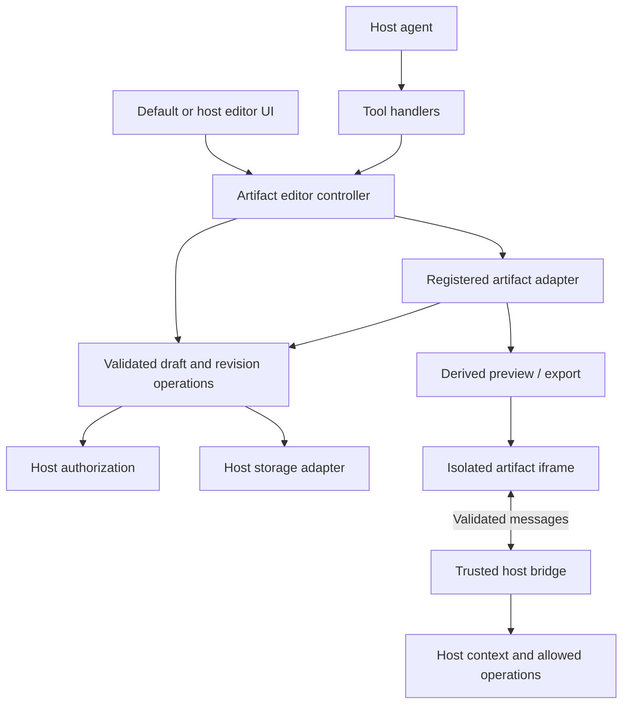

# SDK architecture

Status: Proposed design. The repository has no implementation yet.

This document expands [README](../../README.md). Follow the [implementation plan](../plans/2026-10-09-sdk-implementation-plan.md) for delivery order and the [runtime contract](../contracts/runtime-sdk.md) for communication with generated content.

The architecture follows an established editor-SDK pattern: layered packages, a public editor controller, structured state, registered extensions, and a replaceable default UI. Product reference studies that informed it are kept locally in docs/references and are not committed.

## Product boundary

Open Artifacts is an embeddable SDK for products with AI agents. A host product supplies identity, authorization, storage, model execution, and its surrounding UI. The SDK supplies artifact contracts, editor integration, revisions, tools, and isolated previews.

There are two APIs with different trust boundaries:

- The trusted host integration API mounts editors and performs authorized artifact operations.
- The artifact runtime API executes inside an untrusted preview and receives only explicitly supplied context or capabilities. It cannot authorize writes to saved artifacts.

## Proposed packages

Names are provisional and are not published install targets.

| Directory | Responsibility | Dependency rule |
| --- | --- | --- |
| packages/core | Typed editor controller, document/schema/store boundaries, adapter contracts, revisions, shared events | No DOM, React, editor-library, or model-provider dependency |
| packages/embed | Plain JavaScript mounting, default editor UI and replaceable slots, adapter lifecycle, preview hosting | Uses core; loads selected adapters |
| packages/react | Optional React wrapper for the trusted embedding API | Uses embed; React is a peer dependency |
| packages/runtime | Artifact-side context/theme client and trusted host bridge entry point | No editor or React dependency in the base entry; optional React hooks through a separate entry |
| packages/tools | Provider-independent agent tool definitions and handlers that call the core controller | Uses core; no editor, DOM, or model-provider dependency |
| packages/adapter-html | GrapesJS project editing, supported operations, HTML/CSS export | Uses core and GrapesJS core |
| packages/adapter-document | A future ProseMirror document adapter | Installed only when enabled |
| packages/adapter-layout | A future Puck component-layout adapter | Installed only when enabled |
| packages/adapter-app | A future CodeMirror/Sandpack source adapter | Installed only when enabled |

Host React wrappers and artifact React hooks serve different callers. Neither may create a second persistence path. Optional editors and runtimes must not become transitive imports of core.

### Core layers and editor controller

Organize core into model/schema, store, and controller modules. The schema layer validates artifact envelopes and adapter payload versions. The store maintains immutable observable snapshots of the current draft and last saved revision. The controller exposes supported operations to trusted consumers. These begin as internal modules in core; a separate npm package for every module is unnecessary initially.

The proposed ArtifactEditorController exposes getSnapshot(), subscribe(), applyChanges(), undo(), redo(), save(), and dispose(). Hosts receive it through createArtifactEditor() or the embedding lifecycle. Each method operates on a typed registered adapter. UI commands and agent changes use those operations rather than manipulating rendered DOM or leaking editor-library internals into host integrations.

The controller is testable without mounting a browser editor. Embed attaches an adapter's editor view to it; the optional React wrapper supplies the same instance through context/hooks and a mount callback. UI visibility and theme changes do not create artifact revisions. The artifact-side runtime client never receives this privileged controller.

### Adapter registration and UI extension points

Register adapters explicitly by kind and adapter ID. Core registration supplies DOM-independent payload validation/versioning, supported operation definitions, serialization, migrations, and derived output contracts. Embed separately registers the editor view factory against the same adapter ID, keeping DOM types and editor imports outside core. Reject duplicate IDs and mismatched artifact kind/schema registrations before opening an artifact. Defer loading optional editor code until the selected artifact needs it.

Ship a default shell with a toolbar, inspector, version panel, and save/conflict status. Hosts can hide or replace those named slots through the embedding API. Plain JavaScript slots use mount/cleanup callbacks; React slots are translated by the React wrapper. Slot implementations issue controller commands and subscribe to state. They do not perform independent storage writes or bypass authorization. Unmount removes views, slot callbacks, subscriptions, and preview connections.

## Canonical artifact source

A saved revision contains artifact ID, host-defined scope, title, artifact kind, revision number, envelope schema version, adapter ID and schema version, editable payload, asset references, and host-recorded time/change origin.

| Kind | Canonical editable payload | Derived output |
| --- | --- | --- |
| html | GrapesJS project JSON | HTML/CSS and interactive preview |
| document | Adapter-defined document JSON | Rendered document and supported exports |
| layout | Registered component layout JSON | Rendered component tree |
| app | Source files, entry point, and dependency configuration | Built application preview |

Planned export formats per kind. Only the HTML row is in the first milestone; the rest are targets for their adapters and may change when those adapters start.

| Kind | Export formats |
| --- | --- |
| html | Single HTML file with inlined CSS; HTML and CSS as separate files; zip including referenced assets |
| document | Canonical document JSON; Markdown; static HTML |
| layout | Canonical layout JSON; static HTML render of the component tree |
| app | Zip of source files with entry point and dependency manifest |

Every export is derived from the canonical payload at a named revision and is never read back as the persistence model.

The [GrapesJS storage guide](https://grapesjs.com/docs/modules/Storage.html#project-data) requires project JSON for reliable reopening; exported HTML/CSS is not the persistence model. Its [editor API](https://grapesjs.com/docs/api/editor.html#getprojectdata) provides project serialization/loading. The HTML adapter wraps those operations and saves through core.

Editor documents, drafts, saved revisions, and runtime session state are distinct. Runtime state such as a selected tab does not change the saved project. Editing preview DOM does not save an artifact.

The controller snapshot separates the saved revision/baseRevision, editable document draft with a local draftGeneration, and editor session state such as selection or active panel. Only the versioned canonical document belongs in the shared revision payload. Keep session preferences scoped to the host user/editor instance; never restore another user's session as part of document restoration. Maintain the adapter's native project structure instead of normalizing its internals into a generic shape-record model.

### Transactions, history, and events

Apply a targeted operation list as one validated draft transaction. If any operation fails, the draft and history remain unchanged. A successful batch emits one document-change event and forms one undo group. The controller checks expectedDraftGeneration for changes based on a local draft; save separately uses baseRevision for the host storage comparison. A draft transaction is not a persisted revision.

User undo/redo changes the draft and becomes a new revision only after a successful save. Saved version restoration remains append-only. Keep one authoritative history path per adapter: for HTML, translate GrapesJS native change/history behavior rather than stacking a second independent undo manager over it. Loading, refreshing, or migrating saved content must not be reported as a fresh user edit.

Expose typed document-change, session-change, saved, conflict, and preview-error events with cleanup subscriptions. Source labels distinguish local UI, agent, and external updates for event routing; the trusted host/backend determines authorization and audit identity. Subscribe to relevant state rather than serializing/rebuilding the full editor on every session change.

### Asset integration

Define host-provided upload and resolve operations separately from revision storage. Documents reference stable asset IDs and metadata. The host supplies authenticated upload/resolution outside the artifact; the isolated preview receives only assets permitted by its policy. In-memory examples may inline bounded data URLs. Durable asset uploads, external URL policy, and self-contained export behavior must be implemented and tested before those capabilities are advertised.

## Shared update flow

1. The host supplies trusted caller and scope context. Artifact payloads cannot choose their caller, permissions, or tenant.
2. Core authorizes the operation and resolves the saved revision and selected adapter.
3. The adapter validates the payload/schema or applies a supported targeted operation to a copy of the current editable source.
4. The storage adapter atomically compares the requested base revision and appends the new revision while advancing the head. Validation alone does not prevent concurrent writes.
5. Core emits a saved event only after storage succeeds. On failure, retain the editor draft and expose a structured error.

The storage backend must enforce its own trusted authorization boundary. A browser callback that returns true is insufficient protection for a production backend.

Example: user and agent both read revision 4. The user saves a blue heading as revision 5. The agent's update with baseRevision 4 returns a conflict and does not replace revision 5. The agent reads revision 5 and retries its targeted change against that revision.

Use stable component IDs and adapter-defined changes for agent operations. Avoid replacing the whole project for a small text/style edit. When a new external revision arrives while the editor has unsaved changes, preserve that draft and request reconciliation.

Restoring revision 2 while the head is 5 creates revision 6 with restored content; historical entries remain immutable. Restore uses the same base revision, authorization, and validation rules as save. Migrate old payloads through explicit versioned migrations; reject unsupported schemas without modifying saved history.

## Editor and preview isolation

The HTML editor operates on validated project data with generated script execution disabled. Validate or remove executable HTML, event attributes, dangerous URLs, and unapproved component script fields before the data reaches a trusted editor canvas. Built-in parsing or an editor iframe is not sufficient isolation for arbitrary agent output.

Interactive generated content runs in a separate sandboxed iframe without allow-same-origin. For the initial runtime slice, use inline/self-contained assets, nonce- or hash-authorized scripts, and a restrictive CSP including default-src 'none', connect-src 'none', form-action 'none', and base-uri 'none'. Define any additional asset sources explicitly when that capability is implemented. See [iframe sandbox semantics](https://developer.mozilla.org/en-US/docs/Web/HTML/Reference/Elements/iframe#sandbox).

The host supplies theme and locale as session context. Locale comes from the host product's own user settings, is published to the preview and the default shell, and is never stored in the artifact revision. The host bridge binds each connection to a particular iframe, artifact, viewed revision, and session. Every script in that iframe has the same available runtime authority; an SDK wrapper is not a permission boundary. Secrets, auth tokens, private host state, and raw network access stay outside the artifact. The [runtime contract](../contracts/runtime-sdk.md) defines message validation and lifecycle.

## Extension and maintenance

An adapter must define its schema, validation, supported edits, serialization, migrations, preview, and exports; the typed registration shape is in the [embed API](../contracts/embed-api.md#adapter-registration). Add an adapter round-trip and conflict acceptance scenario before enabling a new artifact kind.

Keep package SemVer, artifact envelope schema, adapter payload schema, and runtime protocol versions independent. Record dependency/runtime versions when generating previews so upgrades are reproducible. Package names, supported browsers, release tooling, and version ranges will be fixed during implementation and verified against real consumers.

MCP agent tools or MCP Apps interoperability can be added as explicit adapters. A custom JSON-RPC bridge does not itself implement MCP Apps. No Cloudflare deployment, hosted account model, or code from another open-artifacts project is assumed by this architecture.
