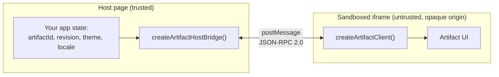
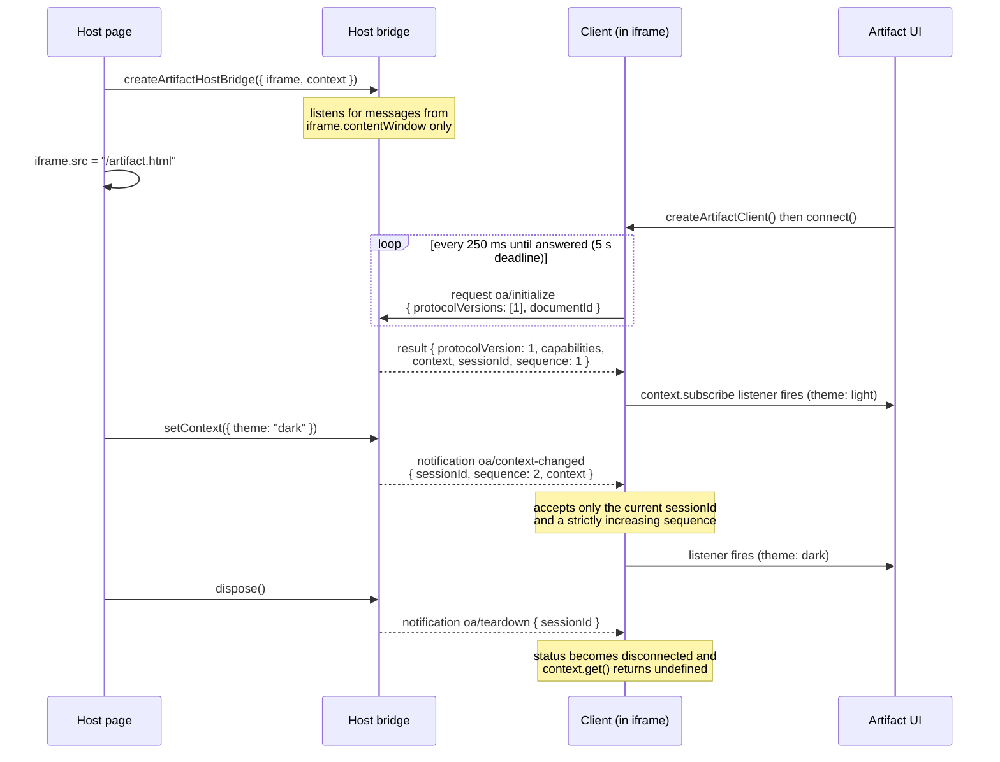
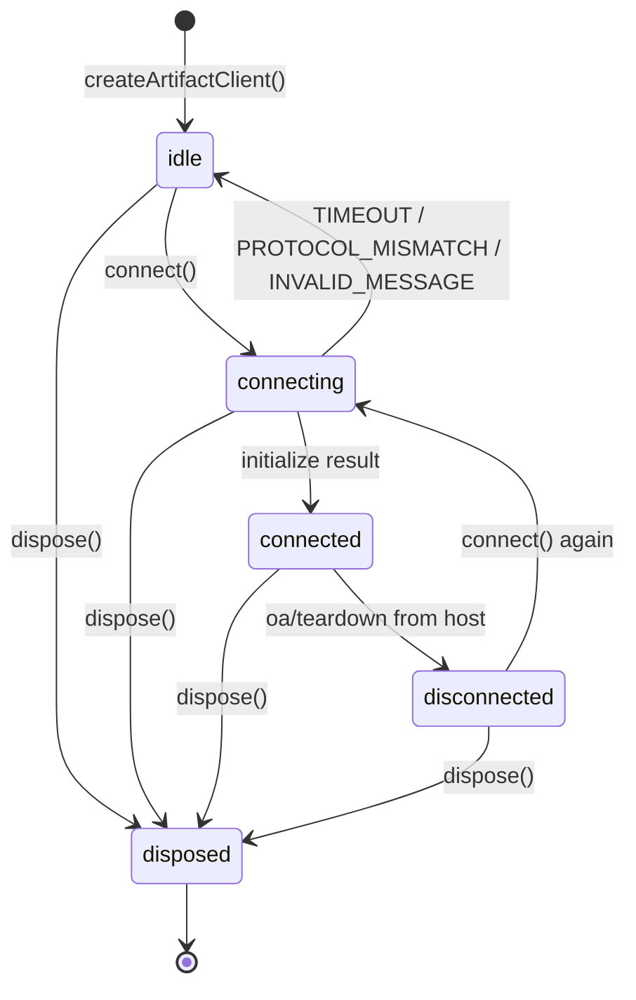
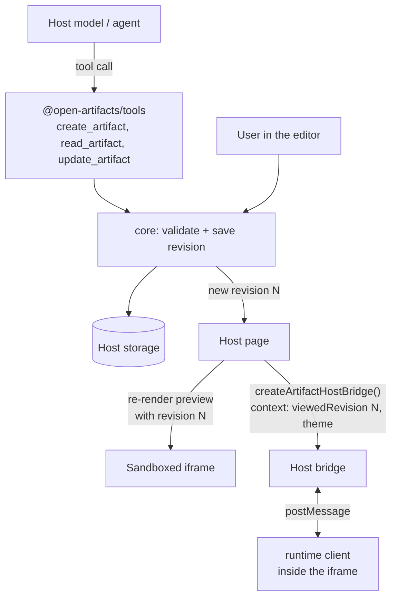

# Runtime walkthrough

This page explains `@open-artifacts/runtime` by walking through one complete session: a host page embeds an artifact, the artifact asks who it is, the user switches to dark mode, and the host tears the preview down. The formal rules are in the [runtime SDK contract](../contracts/runtime-sdk.md); this page is the readable version.

## The problem it solves

An artifact runs inside an iframe with `sandbox="allow-scripts"` and no `allow-same-origin`. That gives it an **opaque origin**: it cannot read the parent page, cannot read cookies, and has no idea which artifact it is, which revision is being viewed, or whether the user has dark mode on.

The only channel between the two is `window.postMessage`. The runtime package wraps that channel on both sides so that neither the host nor the artifact has to hand-roll message parsing, retries, or validation.



Two rules fall out of this picture:

- The **host bridge** is loaded only in the trusted page. It owns the truth about identity and theme and never accepts replacements from the artifact.
- The **client** is loaded only inside the iframe. It can read context and subscribe to changes, nothing more. In v1 the two capabilities are `context.read` and `context.subscribe`.

## The two sides in code

**Host page.** Create the bridge before setting `iframe.src`, so the listener is already in place when the artifact's first message arrives.

```ts
import { createArtifactHostBridge } from "@open-artifacts/runtime/host";

const iframe = document.createElement("iframe");
iframe.sandbox.add("allow-scripts"); // opaque origin on purpose

const bridge = createArtifactHostBridge({
  iframe,
  context: {
    artifactId: "art_plain_01",
    viewedRevision: 4,
    kind: "html",
    theme: "light",
    locale: "en-US",
  },
});

iframe.src = "/artifact.html";
document.body.append(iframe);

// Later, when the user toggles dark mode:
bridge.setContext({ theme: "dark" });

// When the preview is closed:
bridge.dispose();
iframe.remove();
```

**Artifact, plain HTML.** The IIFE build exposes `window.OpenArtifacts`, so a classic script tag is enough.

```html
<script src="/runtime.global.js"></script>
<script>
  var client = window.OpenArtifacts.createArtifactClient();

  // Fires with the current snapshot as soon as one exists, then on every change.
  client.context.subscribe(function (context) {
    document.documentElement.dataset.theme = context.theme;
    document.title = context.artifactId + " @ r" + context.viewedRevision;
  });

  client.connect().catch(function (error) {
    console.warn("not embedded in a host:", error.code);
  });
</script>
```

**Artifact, React.** One provider owns the client; any component reads the state through hooks.

```tsx
import { ArtifactProvider, useArtifact } from "@open-artifacts/runtime/react";

function View() {
  const { status, context, error } = useArtifact();
  if (error) return <p>Could not reach the host: {error.code}</p>;
  if (!context) return <p>{status}...</p>;
  return (
    <main data-theme={context.theme}>
      {context.artifactId} at revision {context.viewedRevision}
    </main>
  );
}

createRoot(root).render(
  <ArtifactProvider>
    <View />
  </ArtifactProvider>,
);
```

Both artifact variants are runnable under `examples/plain-html-runtime` and `examples/react-runtime`.

## One session, message by message

Every message is a JSON-RPC 2.0 envelope sent with `postMessage`. Three methods exist in v1:

| Method | Direction | Kind | Meaning |
| --- | --- | --- | --- |
| `oa/initialize` | artifact to host | request | "Who am I, and what may I do?" |
| `oa/context-changed` | host to artifact | notification | "Theme or locale changed." |
| `oa/teardown` | host to artifact | notification | "This session is over." |



Step by step:

1. **Bind first, navigate second.** The host creates the bridge, then sets `iframe.src`. The bridge only ever answers messages whose `event.source` is that iframe's window, so a second iframe on the same page cannot hijack the session.
2. **The artifact knocks until someone answers.** `connect()` sends `oa/initialize` immediately and again every 250 ms with the same request ID. If the host is slower to bind than the artifact is to boot, nothing is lost. After 5 seconds with no reply, `connect()` rejects with a `TIMEOUT` error. Both intervals are options on `createArtifactClient`.
3. **The host answers once per document.** The reply carries the context, the granted capabilities, a `sessionId`, and a `sequence` counter starting at 1. The client freezes the snapshot and resolves `connect()`. Any `context.subscribe` listener registered earlier fires now.
4. **Changes are pushed, not polled.** `setContext` bumps `sequence` and sends `oa/context-changed`. The client applies it only if the `sessionId` matches and the `sequence` is higher than the last one it saw, so a late or duplicated message cannot roll the theme backwards. Calling `setContext` with no actual change sends nothing.
5. **Reloads start a new session.** The client sends a per-document `documentId` in initialize. If the iframe reloads, the new document sends a new ID and the bridge issues a fresh `sessionId`; notifications aimed at the old document are ignored by the new one. Two clients created in the same document share one session.
6. **Teardown is graceful.** `dispose()` on the bridge sends `oa/teardown`. The client moves to `disconnected`, clears its context, and stops listening. It may call `connect()` again later if a new bridge appears. `dispose()` on the client is terminal and rejects any pending `connect()` with `DISPOSED`.

## What the client validates

Everything that crosses the iframe boundary is parsed before either side acts on it:

- Messages over 16 KiB are dropped on both sides.
- Malformed JSON-RPC from the host is dropped by the client. Malformed JSON-RPC from the artifact gets a `-32600` error reply when an ID is recoverable, so a client is never left hanging.
- A host that speaks JSON-RPC but does not implement `oa/initialize` produces a `PROTOCOL_MISMATCH` error, not a hang. A host that selects an unsupported protocol version produces the same error.
- A reply to a request ID the client is no longer waiting for is ignored.

The client's error codes are `TIMEOUT`, `PROTOCOL_MISMATCH`, `INVALID_MESSAGE`, `DISCONNECTED`, `DISPOSED`, and `HOST_UNAVAILABLE`. The last one is returned immediately when there is no parent window at all, which is what happens when someone opens the artifact file directly in a browser tab.

## Client status over time



`client.status` exposes the current state and `client.subscribeStatus(listener)` reports transitions. The React hook mirrors both into component state.

## Try it

```sh
pnpm install
pnpm build
pnpm --filter example-plain-html-runtime dev   # or: pnpm --filter example-react-runtime dev
```

Open the printed URL. The host page shows its own artifact ID, revision, theme, and current session ID. The iframe below shows what the artifact received. Press **Toggle theme** and watch both sides change together; press **Destroy** and **Recreate** to see a new session ID issued to the fresh frame. The same scenarios run headlessly in `e2e/runtime-examples.spec.ts`.

## Where the agent fits

The agent never talks to the runtime client. It lives on the trusted side of the boundary and works through the [agent tools](../contracts/agent-tools.md), which save revisions through the same validated path the editor uses. The runtime only tells the preview *which* revision it is showing.



A typical loop in a host product:

1. The user asks the agent for a change. The host passes the model the tool definitions from `createArtifactTools`.
2. The model calls `update_artifact` with its edit and the `baseRevision` it last read. The handler validates the payload, checks authorization, and appends a new revision. If the user saved in between, the handler returns `CONFLICT` and the model reads the head revision and retries.
3. The host sees the new revision, derives a fresh preview from it, and loads that into the sandboxed iframe. Because this is a new document, the client in the iframe sends a new `documentId` and the bridge issues a new session whose `viewedRevision` is the new number.
4. The artifact's own scripts call `createArtifactClient` as before. They learn the artifact ID, the revision on screen, the theme, and the locale, and they render accordingly. They cannot call the agent, cannot save, and cannot read anything the host did not put into the context.

So "how it works with the agent" is: the agent writes revisions on the trusted side, the host chooses which revision the preview shows, and the runtime carries that fact plus the theme into the iframe. Theme and locale are session state and are never written into a revision, by either the user or the agent.

## How a host product adopts it

For a product embedding Open Artifacts, the integration is three steps:

1. **Install the host entry** in the page that renders previews. Build the context from your own state: your artifact ID, the revision you are displaying, the kind, and the user's theme and locale from your settings store. Create the bridge before assigning `iframe.src`. Forward theme and locale changes with `setContext`, and call `dispose` when the preview unmounts.
2. **Make the client available to artifacts.** Serve the IIFE build at a stable URL so plain HTML artifacts can load it with a script tag, or let bundled artifacts import the ESM entry. The agent's generated HTML can reference that URL; the runtime does nothing else to the content.
3. **Keep the preview locked down.** Use `sandbox="allow-scripts"` without `allow-same-origin`, apply the restrictive CSP described in [architecture](../design/architecture.md#editor-and-preview-isolation), and keep tokens and private state out of the context object. Everything you put in `context` is readable by every script in the iframe.

## Comparison with Claude Artifacts

Anthropic has not published the protocol behind Claude Artifacts, so this compares the publicly described shape, not the wire format. Sources: a 2024 interview with the Artifacts team summarised by [Simon Willison](https://simonwillison.net/2024/Aug/28/how-anthropic-built-artifacts), and a [2026 bug report](https://claudeissues.com/issue/42064-bug-published-artifacts-show-blank-screen-postmessage-origin-mismatch-app-localh) that exposed the cross-origin handshake.

| Concern | Claude Artifacts (public description) | This SDK |
| --- | --- | --- |
| Isolation | sandboxed iframe, separate `claudeusercontent.com` origin, CSP | sandboxed iframe without `allow-same-origin`, CSP per [architecture](../design/architecture.md#editor-and-preview-isolation) |
| Host to artifact channel | postMessage handshake, origin-checked | postMessage, JSON-RPC 2.0, source-checked |
| Artifact-side API | `window.claude.*` (model calls, storage, files, viewer identity) | `window.OpenArtifacts` or ESM client; v1 is context read and subscribe only |
| Agent writes | trusted side; the artifact itself may write back only through capabilities the page declares and the platform grants (for example a document that saves new versions of itself) | trusted side through [agent tools](../contracts/agent-tools.md); v1 grants the iframe no write capability |
| Network from the artifact | "limited and controlled" by CSP | `connect-src 'none'`; no network at all |

In both systems the host is the authority: artifact code never holds a token or talks to storage directly, and any write it can make goes through a capability the host granted. The security model and the bridge idea are the same family. This SDK is narrower in runtime capabilities today and broader in editing: users and the agent change one saved artifact through typed adapters with revisions. Richer capabilities such as a request channel from the iframe to the host are reserved in the [runtime contract](../contracts/runtime-sdk.md) and each needs its own authorization and tests.

## CSP status

The preview policy is decided but not yet applied by any code. [Decision 0004](../decisions/0004-asset-transport-and-export-policy.md) fixes it as:

```
default-src 'none'; connect-src 'none'; form-action 'none'; base-uri 'none'; img-src data:
```

The runtime examples under `examples/` use only the `sandbox` attribute, which is enough for a hand-written demo artifact: it blocks access to the parent page and its cookies. It does not stop a generated script from calling `fetch` or loading a remote script. The CSP closes that, and it must ship with the first preview that renders agent-generated HTML. That belongs to the embed package and the HTML adapter, which carry the policy as the `csp` field of the preview document in the [embed API](../contracts/embed-api.md).

For an opaque-origin frame loaded through `srcdoc` or a blob URL the host cannot set a response header, so the policy goes in a `<meta http-equiv="Content-Security-Policy">` tag at the top of the generated document. Scripts inside a sandboxed iframe cannot remove or override that tag ([test by Simon Willison, April 2026](https://simonwillison.net/2026/apr/3/test-csp-iframe-escape)).

## What this slice does not do

The runtime package is the context/theme slice only. It does not save, edit, or load artifact content, and the client cannot ask the host to write anything. Those operations belong to the trusted [embed API](../contracts/embed-api.md) and [agent tools](../contracts/agent-tools.md) and never cross the iframe boundary. The tools package itself is planned for slice 3 and is not implemented yet.
